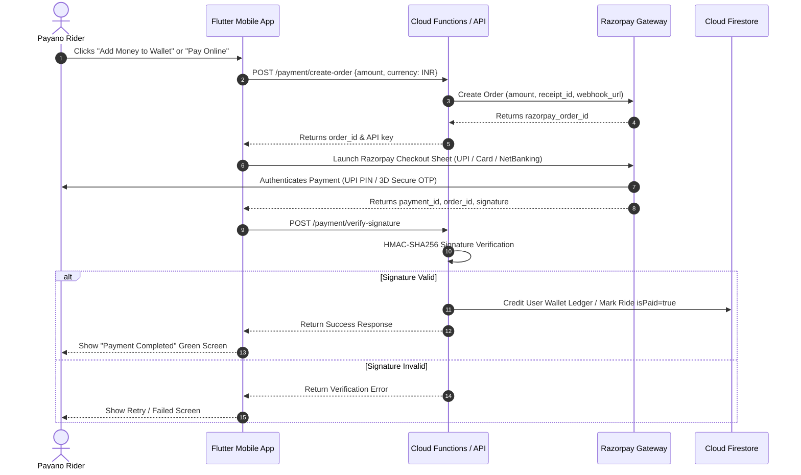

# Payano — Comprehensive System Architecture, App Workflow & Operational Terms of Use

---

## 1. Executive Summary & Platform Overview

**Payano** is a modern, high-performance urban two-wheeler mobility and bike-taxi platform engineered for swift, affordable, and eco-friendly city commuting. 

The Payano ecosystem connects three key stakeholder roles:
1. **Riders (Passengers):** Commuters seeking on-demand, traffic-beating two-wheeler transit, student discount categories, in-app wallet payments, and safety tracking.
2. **Driver-Partners (Captains):** Verified vehicle owners providing point-to-point transit with transparent real-time earnings, turn-by-turn navigation, and automated dispatch.
3. **Platform Administrators:** Operations team overseeing dynamic surge multipliers, driver document verification, dispute handling, and live fleet monitoring.

---

## 2. Technical Architecture & Tech Stack

```mermaid
graph TD
    subgraph Client Layer [Flutter Cross-Platform App]
        RiderUI[Rider Screens: Home, Search, Tracking, Wallet]
        DriverUI[Driver Screens: Dispatch Radar, Ride Nav, Earnings]
        AdminUI[Admin Dashboard: Telemetry, Verification]
        State[State Management: Riverpod & go_router]
    end

    subgraph Backend Layer [Firebase & Python/Node Services]
        Auth[Firebase Authentication: Phone OTP & Google Auth]
        Firestore[(Cloud Firestore: Users, Drivers, Rides, Transactions)]
        Redis[(Redis Geospatial Cache: Driver Telemetry & Radar)]
        Functions[Cloud Functions / Node.js & Python API]
    end

    subgraph External Gateways
        Razorpay[Razorpay Payment Gateway: UPI, Cards, Netbanking]
        GoogleMaps[Google Maps / MapLibre: Geocoding & Turn-by-Turn Navigation]
        FCM[Firebase Cloud Messaging: Instant Push Dispatch]
    end

    Client Layer -->|HTTPS / WSS| Backend Layer
    Backend Layer --> External Gateways
```

### Technology Breakdown
- **Frontend / Mobile:** Flutter 3.x, Dart 3.2+, Riverpod 2.5 (State Management), `go_router 14.6` (Declarative Routing), `maplibre_gl` & `google_maps_flutter` (Live Mapping), `flutter_secure_storage` (Biometric & Token Storage).
- **Backend & Realtime:** Firebase Authentication, Cloud Firestore (Real-time DB), Redis (Geospatial radius queries), Cloud Storage (Driver documents & KYC).
- **Payment Gateway:** **Razorpay Software Private Limited** (PCI-DSS compliant SDK integration for Cards, UPI, Netbanking, and Payano Wallet top-ups).
- **Telemetry & Push:** WebSockets & Firebase Cloud Messaging (FCM) with high-priority data payloads.

---

## 3. End-to-End App Working & User Workflows

```
                                  RIDE LIFECYCLE STATE MACHINE
                                  
 [REQUESTED] ──> [SEARCHING] ──> [DRIVER_ASSIGNED] ──> [DRIVER_ARRIVING] ──> [DRIVER_ARRIVED]
      │               │                 │                    │                   │
      │               │                 ▼                    │                   │
      └──[CANCELLED]──┴───[CANCELLED]───┴────[CANCELLED]─────┴───[CANCELLED]─────┘
                                                │
                                                ▼ (4-Digit Start OTP Verified)
                                         [TRIP_STARTED]
                                                │
                                                ▼ (Drop-off Geofence Reached)
                                         [TRIP_COMPLETED]
                                                │
                                                ▼ (Razorpay / Wallet Deduct)
                                         [PAYMENT_SETTLED]
```

### 3.1. Rider (Passenger) Journey
1. **Onboarding & Authentication:**
   - Welcome carousel highlighting four core ride categories:
     - 🛵 **Payano Lite:** 100–110cc commuter scooters for ultra-short, agile commutes.
     - 🏍️ **Payano Moto:** 125–150cc motorcycles designed for standard traffic maneuvering.
     - ⚡ **Payano Green EV:** Zero-emission electric scooters for eco-conscious commuting.
     - 🚀 **Payano Priority Express:** Top-rated drivers prioritized for urgent transit.
   - Login via Mobile Number with automated 6-digit SMS OTP verification.
   - Profile setup (Name, Email, Emergency Contact for SOS).
   - Optional **Student Verification** (College ID upload for discounted collegiate fares).

2. **Destination Search & Interactive Booking:**
   - Home screen displays user GPS location with nearby active driver pins in real-time.
   - Search autocomplete powered by Google Places API.
   - Route polyline generated with estimated distance (km), estimated time of arrival (ETA), and transparent fare breakdown.
   - Selection of vehicle tier (Lite, Moto, EV, Express) and payment preference (Payano Wallet, UPI, Card, or Cash on Drop).

3. **Driver Matching (Sonar Radar Dispatch):**
   - System locates available online drivers within a 3–5 km radius via Redis geospatial indexing.
   - Dispatches a 15-second prioritized request offer to the nearest active driver.
   - In-app animated radar screen keeps passenger updated on driver matching progress.

4. **Driver Assigned & Live Telemetry:**
   - Shows Driver name, verified badge, photo, vehicle model, color, registration number, and live rating.
   - Real-time map displaying driver's live GPS location heading toward the pickup point.
   - Generates a **secure 4-digit Start OTP** displayed on the rider screen.
   - Direct call/chat masked communication options.

5. **Trip Start & In-Transit Safety:**
   - The driver cannot start the trip until the rider provides the 4-digit Start OTP.
   - Once verified, the trip enters `TRIP_STARTED` status.
   - Rider can share live tracking link with family/friends.
   - Dedicated **SOS Emergency Button** connects to local authorities and dispatches emergency SMS to designated contacts.

6. **Drop-Off, Billing & Feedback:**
   - Upon arriving at the destination, the trip is marked `TRIP_COMPLETED`.
   - The server validates final distance, wait time, tolls, and discounts.
   - Automatic deduction from Payano Wallet or Razorpay payment initiation.
   - Rider rates driver (1–5 stars) and leaves structured feedback.

---

### 3.2. Driver-Partner (Captain) Journey
1. **Driver Registration & KYC Verification:**
   - Registration via mobile phone number.
   - Submission of vehicle details: Model, Make, Registration Number, Commercial License, RC, Vehicle Insurance, and Aadhaar Card.
   - Application placed in `under_review` until verified by the Admin Portal.

2. **Online / Offline Duty State:**
   - Driver toggles online status via top status bar.
   - Background location service streams driver coordinates to the server every 3–5 seconds.

3. **Incoming Ride Offer Modal:**
   - Driver hears an urgent audio chime with a visual overlay showing:
     - Passenger pickup address & distance to pickup
     - Destination address & estimated ride earnings
     - Circular 15-second countdown timer.
   - If accepted, the driver is locked to the ride; if rejected or timed out, the request bounces to the next closest driver.

4. **Pickup & OTP Verification:**
   - Turn-by-turn navigation guides the driver to the passenger's exact GPS coordinates.
   - Upon arrival, the driver clicks "I Have Arrived".
   - The driver inputs the 4-digit OTP provided by the passenger to unlock navigation to the drop location.

5. **Ride Completion & Instant Earnings:**
   - Driver marks trip complete upon reaching destination.
   - Earnings (fare minus platform commission) are credited instantly to the Driver's Daily Earnings ledger.
   - Payout dashboard displays daily rides, total hours online, incentive milestones, and bank withdrawal requests.

---

### 3.3. Admin Portal Operations
1. **Driver Document Approval Workflow:** Verification of uploaded licenses, registration certificates, and insurance documents with one-click approve/reject actions.
2. **Dynamic Surge Multiplier Engine:** Ability to apply regional surge multipliers (e.g., 1.2x – 2.0x) during extreme weather, peak office rush hours, or regional transit strikes.
3. **Live Fleet Monitoring:** Heatmaps displaying active online drivers, active rides, and pending unassigned requests.
4. **Dispute Redressal & Refund Approvals:** Reviewing rider fare overcharges, cancellation disputes, and initiating Razorpay refunds.

---

## 4. Razorpay Payment Gateway & In-App Wallet Architecture



### Key Razorpay Compliance Rules Built-In:
- **Zero Sensitive Data Storage:** Payano never stores full 16-digit PAN, CVV, or Netbanking passwords. All payment instruments are handled inside Razorpay's PCI-DSS Level 1 compliant vault.
- **Webhook Idempotency:** Webhook listeners verify Razorpay signatures and prevent double-crediting through unique transaction ID de-duplication.
- **Automated Reversals:** Transactions debited from customer bank accounts where the network session dropped before order settlement are auto-reversed to source within 3–7 business days by Razorpay.

---

## 5. Comprehensive Terms, Conditions & Usage Rules

### 5.1. General Platform Terms & Intermediary Role
1. **Contractual Relationship:** These terms govern access to the Payano application, website, content, and services. By registering or using the Platform, you enter into a legally binding contract with **Payano Mobility Technologies Private Limited**.
2. **Aggregator & Intermediary Disclosure:** Payano is a technology platform connecting independent third-party mobility service providers with end users. Payano does not operate as a common carrier and does not directly provide transportation services.
3. **Account Eligibility:** Users must be at least **18 years old**. Creating accounts under false identities or using another person’s mobile number without authorization is strictly prohibited.

---

### 5.2. Rider (Passenger) Conditions & Safety Rules
1. **Mandatory Helmet Compliance:** As per Section 129 of the Motor Vehicles Act, every rider must wear a certified protective helmet throughout the duration of the two-wheeler ride. Drivers reserve the right to refuse service without refund if a passenger refuses to wear a helmet.
2. **Single Passenger Restriction:** Two-wheeler rides are strictly legally limited to **one passenger**. Accompaniment of children without helmets or multiple riders is prohibited.
3. **Passenger Conduct:** Passengers shall not carry hazardous chemicals, inflammable substances, alcohol, illicit narcotics, or bulky cargo exceeding 10 kg. Any verbal harassment or physical misconduct will result in permanent blacklisting and immediate reporting to law enforcement authorities.
4. **Start-OTP Verification:** Riders must verify the vehicle registration plate and driver identity prior to entering the vehicle and only disclose the 4-digit Start OTP when physically seated and ready for transit.

---

### 5.3. Driver-Partner Conditions & Operational Standards
1. **Vehicle & License Validity:** Driver-Partners must possess a valid, non-expired Commercial/Transport Driving License, active Vehicle Registration Certificate (RC), commercial insurance policy, and Pollution Under Control (PUC) certificate.
2. **Vehicle Fitness:** All two-wheelers operating on the Platform must be maintained in pristine mechanical condition (functional brakes, dual mirrors, headlights, turn signals, and tires with compliant tread depth).
3. **Clean Spare Helmet Requirement:** Driver-Partners must provide a clean, sanitized, BIS-certified helmet for the passenger.
4. **Zero Tolerance on Substance Abuse:** Driving under the influence of alcohol, narcotics, or prescription medication impairing motor skills is subject to immediate permanent platform debarment and statutory prosecution.
5. **Route Compliance:** Drivers must adhere to standard navigation routes unless an alternate route is mutually agreed upon with the passenger to bypass severe traffic congestion.

---

### 5.4. Fare Calculation, Surge Pricing & Dynamic Rates
1. **Base Rate Structure:**
   - **Payano Lite:** Base Fare ₹15 | Per Km ₹7.50 | Per Min ₹1.00
   - **Payano Moto:** Base Fare ₹20 | Per Km ₹9.00 | Per Min ₹1.20
   - **Payano Green EV:** Base Fare ₹18 | Per Km ₹8.00 | Per Min ₹1.00
   - **Payano Priority Express:** Base Fare ₹30 | Per Km ₹12.00 | Per Min ₹1.50
2. **Dynamic Surge Multipliers:** Surge rates (ranging from 1.1x to 2.0x) apply transparently during adverse weather (heavy rain), festival spikes, night hours (11:00 PM – 05:00 AM), or acute driver shortages.
3. **Platform Convenience Fee:** A standard technology facilitation fee of ₹3–₹5 per completed booking is included in the fare invoice.
4. **Tolls and Parking:** Any municipal parking fees or expressway toll charges incurred along the chosen route are payable by the passenger.

---

### 5.5. Cancellation & No-Show Conditions
1. **Rider Cancellation Policy:**
   - **Free Window:** Passengers may cancel a ride without penalty within **3 minutes** of booking confirmation.
   - **Cancellation Penalty:** If cancellation occurs after 3 minutes, or after the driver has arrived at the pickup location, a cancellation fee of **₹20.00** will be levied to compensate the driver for fuel and dispatch time.
2. **Driver No-Show:**
   - If a driver fails to arrive within 10 minutes past the estimated ETA, the rider may cancel without any fee.
   - If a driver arrives and waits more than 5 minutes at the designated pickup pin while attempting to call the passenger without response, the driver may cancel the ride under "Rider No-Show", and a cancellation fee will be charged to the passenger.
3. **Driver Cancellation Penalties:** Driver-Partners who arbitrarily cancel rides after acceptance without valid justification will incur platform acceptance-score penalties, affecting priority dispatch eligibility.

---

### 5.6. Refund & Settlement Policy (Razorpay Standards)
1. **Refund Eligibility Criteria:**
   - Rides charged but not completed due to vehicle breakdown or technological errors.
   - Double deductions or accidental duplicate wallet top-ups.
   - Disputed cancellation fees where driver telemetry confirms the driver was substantially off-route.
2. **Refund Turnaround Timelines:**
   - **Payano In-App Wallet:** Credited within **1 to 2 hours** following dispute resolution.
   - **Original Source Account (Razorpay - Bank / UPI / Credit Card):** Processed and dispatched within **5 to 7 business days** to the original payment instrument.

---

### 5.7. Student Verification Program
1. **Program Benefits:** Enrolled college/university students are eligible for up to **15% discounted fares** on Payano Lite and Payano Green EV rides.
2. **Verification Requirements:** Submission of a clear photograph of an active, accredited University/College Student ID card with visible validity dates.
3. **Revocation:** Discounts are non-transferable. Permitting third parties to utilize a student-verified account will lead to discount forfeiture and account suspension.

---

### 5.8. Data Privacy & Telemetry
1. **Location Data:** The App collects precise foreground and background geolocation telemetry to facilitate trip matching, live route navigation, passenger safety, and dispute resolution.
2. **Data Sharing:** Contact numbers between riders and drivers are masked via proxy telephony/virtual numbers to safeguard personal privacy.
3. **Data Retention:** Trip logs and payment transaction IDs are archived in encrypted storage in compliance with Indian Information Technology and RBI financial record-keeping regulations.

---

### 5.9. Grievance Redressal & Customer Support
In accordance with the Information Technology Act, 2000 and the Consumer Protection (E-Commerce) Rules, 2020:

- **Entity Name:** Payano Mobility Technologies Private Limited
- **Support Email:** `support@payano.in`
- **Grievance Redressal Officer:** Head of Safety & Operations
- **Officer Email:** `grievance@payano.in`
- **Physical Corporate Address:** [Office Address, Tech Park, City, State, PIN, India]
- **Turnaround SLA:** Acknowledgement within **48 hours**; complete investigation and redressal within **30 business days**.

